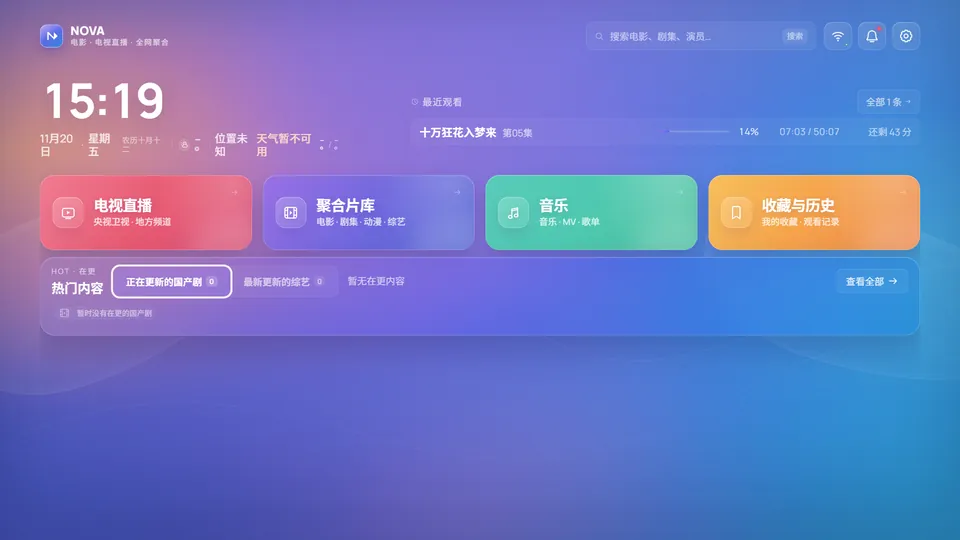
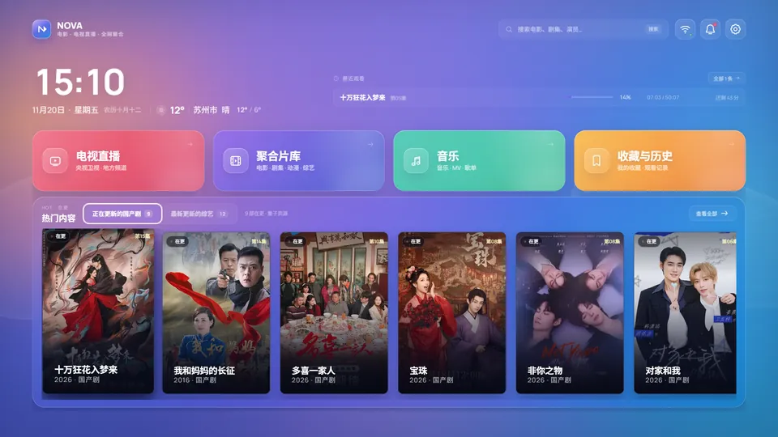
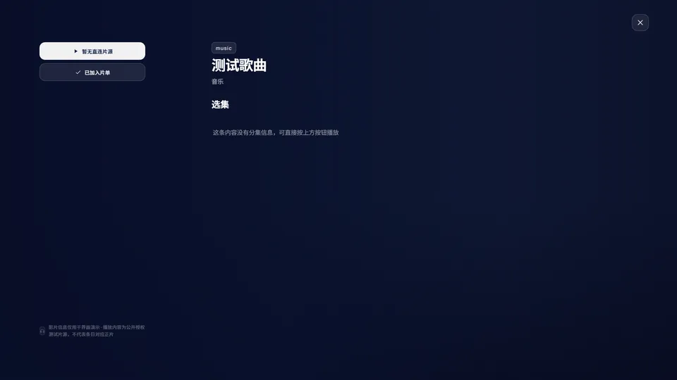
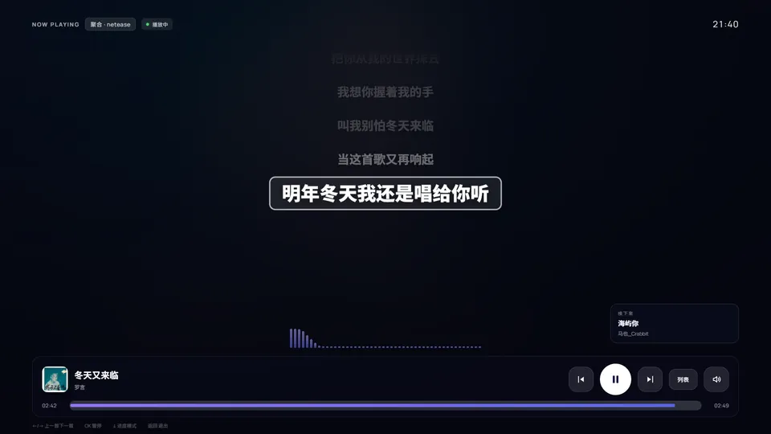
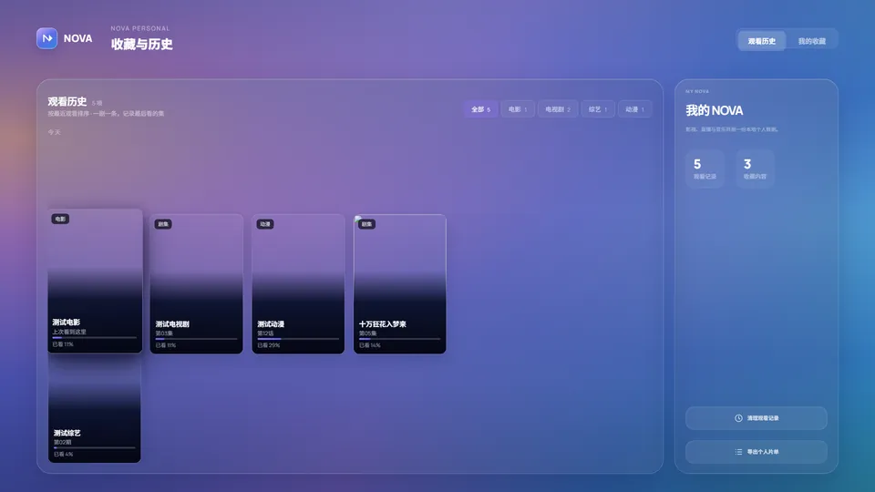

# NOVA TV

电视端影视聚合应用 + 管理后台 + Android TV 安装包，一个仓库装齐。

```
web/        电视端前端（1080 逻辑像素画布，遥控器操作）
admin/      管理后台（订阅 / 站点 / 直播源 / 解析 / 发布）
server/     本地服务（静态预览 + /api/proxy + 后台接口）
android/    Android TV 壳工程（WebView + 内置 HTTP 服务）
dist/       打包好的 APK
```

## 功能

**电视端**

- 首页：最近观看（文字版 3 行）、功能入口、热门内容单行 + 分类 chip 切换
- 聚合片库：多源聚合、分类切换、详情页选集 / 换线
- 播放器：HLS 播放、进度记忆、换源、倍速、收藏
- 音乐：在线曲库 + 电台 + 搜索 + 全屏歌词 + 封面模糊背景 + WebAudio 频谱
- 片单：收藏与观看历史，五类筛选，长按删除，导出
- 直播：M3U / TXT 直播源、EPG、线路探测排序
- 设置：10 个分区，全部持久化到 localStorage

**管理后台**

- 订阅导入（远程地址 / 粘贴 JSON / 本地文件 / 内置预设）
- 站点健康检查、启用开关、批量测试
- 直播源与解析接口管理
- 一键发布：把启用内容打包成一份聚合配置

**电视化细节**

- 全站字号 ≥16px、对比度 ≥4.5:1、可点区域 ≥48px
- 焦点环 4px + 4px offset，卡片聚焦放大 1.05 + 外发光
- 行式导航：竖直移动保留起点列，不会左右乱跳
- 首页锁一屏，不做上下滚动

## 内置内容源

首次启动自动写入 7 个订阅、22 个站点、1 个直播源，全部默认开启：

| 订阅 | 站点 |
|---|---|
| NOVA 合并包 | 16 个公开采集站 + 公开 IPTV 直播源 |
| 量子资源 / 非凡资源 / 电影天堂 / 光速资源 / 素博资源 | 各 1 站 |
| 无尽资源 | 1 站 |

用户手动关闭或删除的状态会被记住；删光后重启会自动恢复。

## 运行

**前端预览**

```bash
node server/preview-server.mjs        # 默认 http://127.0.0.1:4178
```

**管理后台**

```bash
node server/admin-server.mjs
```

**打包 APK**

```bash
cd android
powershell -ExecutionPolicy Bypass -File build.ps1
# 产物 dist/nova-tv.apk
```

需要 Android SDK build-tools 34 + platform-34 + JDK 17。脚本顶部三行写死了本机路径，换机器改这三行。

## 目录细节

```
web/
  index.html                 单页骨架
  styles.css pages.css library.css category.css live.css
  sources.css player.css tv-scale.css     电视化标尺（最后加载）
  app.js                     焦点导航 / 搜索 / 详情 / 返回栈
  pages.js                   页面容器 / 片单 / 设置
  library-ui.js              聚合片库 + 首页热门带
  category-ui.js  live-ui.js  分类页 / 直播页
  player.js                  HLS 播放器
  music-source.js            曲库与电台
  sources.js                 订阅与站点模型（3.4k 行）
  push-bridge.js             手机推送订阅（APK 内可用）

admin/
  index.html  admin.js  admin.css
  data/nova/                 站点库、发布快照、设置

server/
  preview-server.mjs         静态预览 + /api/proxy
  admin-server.mjs           后台接口
  proxy.mjs                  代理实现

android/
  app/src 结构见 app/AndroidManifest.xml
  app/java/com/nova/tv/MainActivity.java    WebView 壳 / 遥控器键位
  app/java/com/nova/tv/LocalServer.java     本地 HTTP + /api/proxy + /push
  app/assets/www/                          构建时从 ../../web 同步
```

## 手机推送订阅

电视上输订阅地址很痛苦，所以 APK 里带了一个局域网推送页：

```
电视：设置 → 订阅与内容源 → 显示接收地址 → 显示 http://<IP>:<端口>/push + 4 位配对码
手机：浏览器打开该地址 → 输入配对码 → 粘贴订阅地址 → 发送
电视：1.5 秒内收到并自动导入
```

服务实现见 `android/app/java/com/nova/tv/LocalServer.java`，前端见 `web/push-bridge.js`。

## 截图








## 已知边界

- 需要联网拉取片源与海报，仓库不含版权内容
- 老盒子 WebView < Chromium 60 时 HLS 可能不可用
- 仅适配横屏电视；手机竖屏未做布局
- 内置源是公开苹果 CMS 接口，随时可能失效，失效后在后台逐个测试即可

## License

MIT
