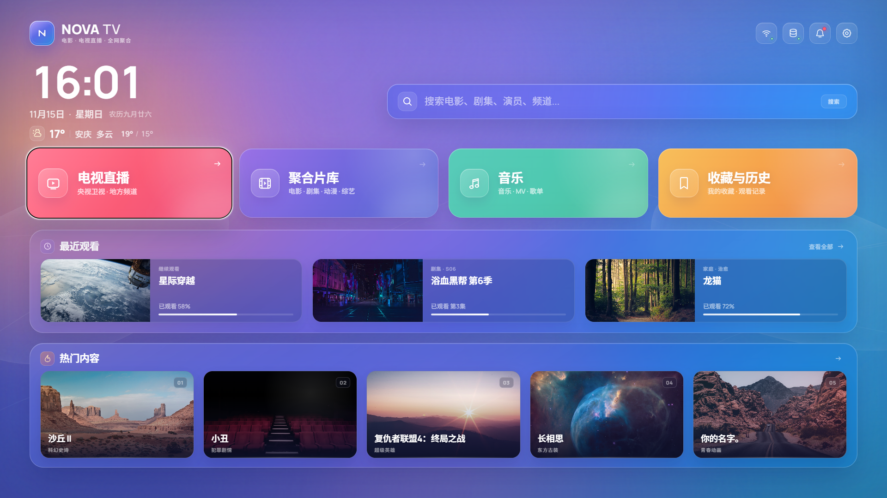
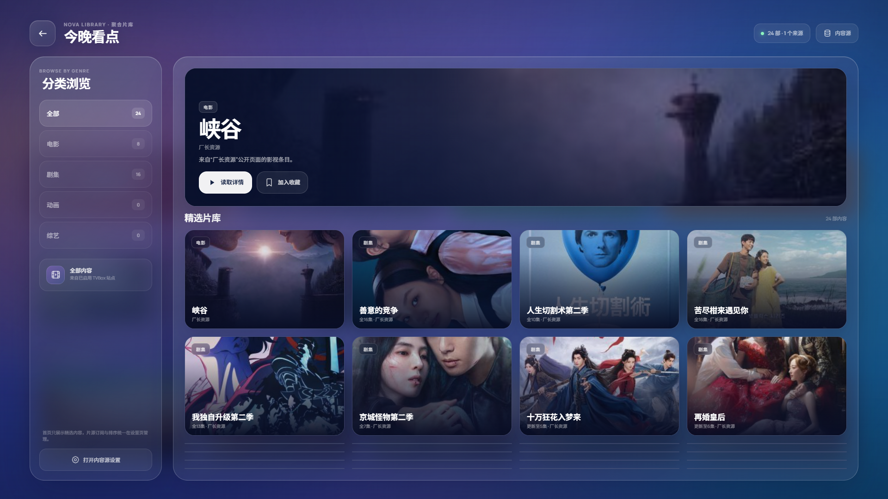
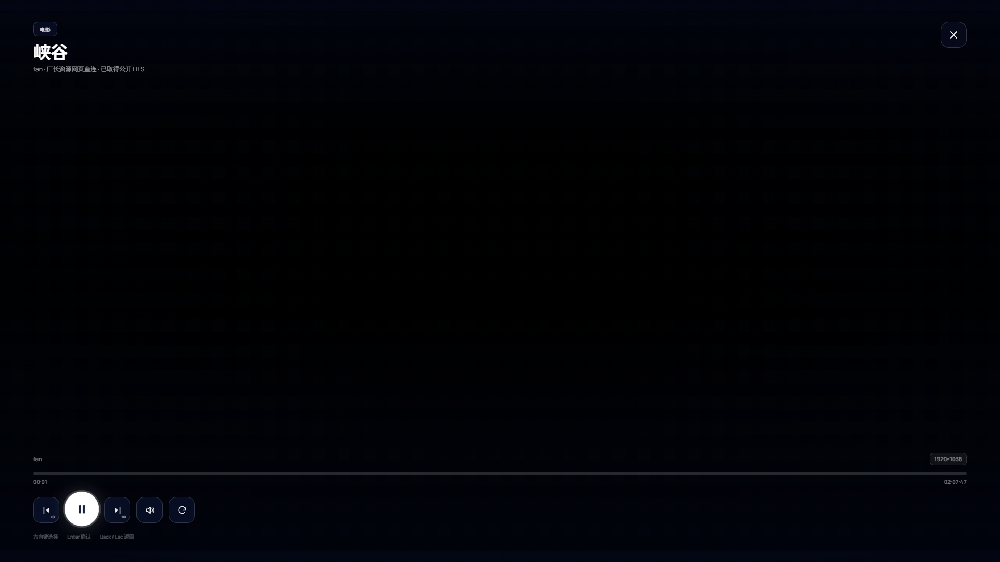

# NOVA TV

NOVA TV 是一个面向 Android TV / 电视大屏的影视聚合平台原型，包含可运行的浏览器交互试用版和 Kotlin + Jetpack Compose 原生工程。

当前仓库用于阶段性评审，不是正式发行版本，也不包含 APK / AAB。

## 目录

```text
preview/   浏览器试用版与本地 Node 代理
android/   Android TV 原生工程源码
screenshots/ 首页、直播、片库、音乐、设置和真实源截图
```

## 浏览器试用版

要求 Node.js 18 或更高版本。

```powershell
cd preview
.\start-preview.cmd
```

也可以直接运行：

```powershell
node preview-server.mjs
```

默认地址为 `http://127.0.0.1:4178/`。不要直接双击 `index.html`，因为内容源同步、图片代理和 HLS 播放依赖本地预览服务。

试用版已实现：

- 1920×1080 电视逻辑画布，等比适配 1366×768、1080P 和 4K；
- 遥控器方向键、Enter、Back / Esc 焦点导航；
- 电视直播、聚合片库、音乐、收藏与历史、设置；
- TVBox A/B 配置解析、苹果 CMS、HTML 规则和标准 M3U / TXT 直播；
- 公开网页兼容站点“厂长资源”的片库、搜索、详情和公开 HLS 播放；
- 本地音乐试听队列与独立音乐页面。

更多功能和验证说明见 [`preview/README.md`](preview/README.md)。

## Android 原生工程

原生工程位于 [`android/`](android/)，当前用于评审 Compose UI、遥控器焦点和模块结构。构建要求：

- JDK 17
- Android SDK Platform 35
- Android Build Tools 35.0.0
- Gradle 8.9 Wrapper

```powershell
cd android
.\gradlew.bat :app:compileDebugKotlin :app:testDebugUnitTest
```

真实 TVBox 适配目前先在浏览器试用版验证，尚未完整移植到 Android 原生端。

## 内容源边界

- 标准 TVBox 苹果 CMS、HTML 规则和 M3U / TXT 直播列表可直接解析；
- `fan` 配置中只有“厂长资源”公开网页直连完成验证，其余 48 个 `csp_*` / Spider 站点仍需私有运行时；
- Spider `type=0`、jar、dex 和 drpy provider 只做识别，不会在浏览器预览版中执行；
- 不实现虎牙、抖音等平台房间号换地址；
- 不绕过 DRM、付费、登录、签名、防盗链或地区限制。

## 截图







## 状态

浏览器试用版的真实片库、搜索、详情、公开 HLS 播放、完整 UI 焦点和 TVBox 代理安全回归均已通过。Android 原生工程尚未生成 APK，真实内容源链路仍需后续迁移。

## License

MIT
